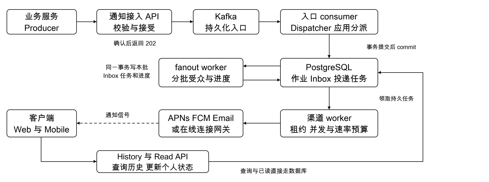
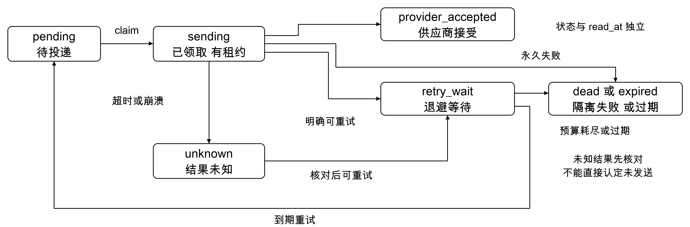
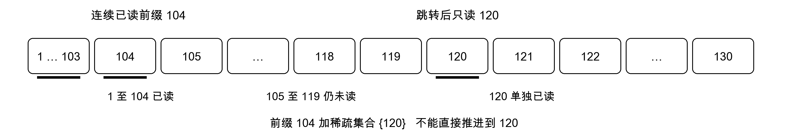

# 通知系统中高级面试准备

Mid Senior Notification System Interview Prep

面向 45 至 60 分钟系统设计面试。本文采用社交产品的站内通知中心与移动推送场景，回答需求澄清、容量、接口、存储、可靠投递、热点扩散、已读和运维追问。所有吞吐与延迟数字都是设计假设，尚无实现或压测证据。编制日期为 2026 年 11 月 1 日。

## 开场先确定边界

“我先按评论、点赞、@ 和订阅更新触发通知来设计，支持站内历史、点击跳转、已读与手机推送。正文和关注关系由已有业务系统管理。需要我同时设计聊天历史，还是主要讨论通知投递与大规模 fanout？”

默认不包含推荐 feed、完整聊天、行情传输和营销平台。Slack 型需求增加会话顺序与群聊同步；财经快讯型需求强调突发广播、订阅匹配和过期。场景不同，模型随之变化，不把三种产品全部装进第一版。

## 先问五件会改变设计的事

- 谁产生事件，谁决定接收者？调用方给 user_id，还是通知系统解析 audience_ref？
- 规模是 DAU、每天收件条目、最大单次受众，还是并发在线连接？
- 200ms 指持久入队、Inbox 可见、供应商接受，还是客户端收到？
- 允许重复、丢失、乱序和多长延迟？哪些通知会过期？
- 已读指单条、连续前缀，还是群内公开回执？是否支持跳读与全部已读？

## 面试时间分配与阅读路线

| 时间 | 目标 | 本文页码 |
| --- | --- | --- |
| 0 至 8 分钟 | 明确范围、量级与 SLO | 1 至 2 |
| 8 至 23 分钟 | 画主链路、API 和数据模型 | 3 至 6 |
| 23 至 43 分钟 | 深挖 fanout、可靠性和已读 | 7 至 11 |
| 43 至 55 分钟 | 运维、故障和规模变化 | 12 至 14 |

**回答主线。** Kafka 接受事件，consumer 把责任交给持久化 fanout job；批量生成 Inbox 与投递任务；worker 有界调用供应商；查询和已读走独立 API。全文内部 event_key 为 (producer_id, event_id)，E42 是该复合标识的简写。

先读第 3、4、9、11、12 页，再用第 14 页练习口述。术语首次出现时附英文，第 15 页列出核心缩写和参考来源。本文是设计准备材料，不是生产能力声明。

<!-- PAGE -->
# 02 量级估算与服务目标

## 把 DAU 拆成实际工作量

日活跃用户数 Daily Active Users（DAU）是输入假设。离线用户也可能收通知，因此“每天接收通知的用户数”不一定等于 DAU。假设两者暂时相同，100 万用户每人每天收到 20 条，则每日有 2,000 万条收件记录，平均约 231 条每秒。

| 维度 | 示例或计算 | 需要确认的变量 |
| --- | --- | --- |
| 收件写入峰值 | 平均的 10 倍约 2.3K 条每秒 | 地域、活动、整点广播 |
| 10K 条每秒 | 约为上述平均的 43 倍 | 明确它是峰值假设 |
| 原始存储 | 200B × 2,000 万 × 30 天约 120GB | 未含索引、任务与副本 |
| 保留条目数 | 30 天约 6 亿条 | 清理、分区与索引成本 |
| 平均在线连接 | 100 万 × 每天在线 1 小时 ÷ 24 约 4.2 万 | 峰值、标签页、设备数 |

入口事件量、收件条目和渠道尝试必须分别计算。一个事件通知一百万人，和一百万个单人事件具有不同的热点和突发特征。投递尝试还要乘启用渠道、目标设备并计入重试。若实际每条物理记录为 1KB，6 亿条约 600GB，三个副本约 1.8TB，仍未包含其他表和备份。

## 200ms 仅约束持久化接受

服务水平指标 Service Level Indicator（SLI）是测量口径；服务水平目标 Service Level Objective（SLO）是目标；服务水平协议 Service Level Agreement（SLA）是对外约定。面试中先提出 SLO，不凭架构图承诺 SLA。[S1]

| 边界 | 规划示例 均未压测 | 分母与成功定义 |
| --- | --- | --- |
| 接入 | 99% 在 200ms 内成功入队 | 合法且配额内请求，失败计 bad |
| 站内可见 | 99% 在接受后 1 秒内可查询 | 应生成的个人收件条目 |
| 即时 push | 99% 在接受后 2 秒内被供应商接受 | 应投递的用户 渠道 设备任务 |
| 个人项目宽松目标 | 99% 在 5 分钟内提交 | 可替代上述即时目标 |

供应商接受不等于设备收到，设备收到也不等于用户读过。大广播应另约定“受众中多少比例在多久内完成”，不能用单条投递 p99 证明百万受众全部及时完成。[F1]

**容量判断。** 若流入速率为 λ、处理能力为 μ，持续负载需要 μ 大于 λ 并保留余量。积压 B 条时，无新流入约需 B/μ 清空；持续流入且 μ 大于 λ 时约需 B/(μ−λ)。队列缓冲用延迟换容量，不能消除持续过载。

<!-- PAGE -->
# 03 主架构与技术栈



图 1 发送 查询与已读三条路径。虚线表示实时信号；它丢失后可由查询补齐。框表示逻辑职责，可以同进程部署。

## 同一条事件怎样经过系统

业务服务提交事件 E42。Notification API 验证调用方与参数，将事件发布到 Kafka 并等待确认，然后返回 202。入口 consumer 以 event_key 唯一持久化事件内容与 FanoutJob，DB 提交后再提交消费进度。fanout worker 分批解析受众，原子写入 Inbox、DeliveryTask 和进度；渠道 worker 领取任务并调用供应商。

Dispatcher（通知分派器）是应用中的路由与编排职责，不是 Kafka 内置组件。它可以由 consumer handler 加 fanout worker 实现。你的 producer → broker → consumer → commit 经验完全适用，分派逻辑就在 consumer 后面的业务代码里。

## 我会选择的栈与理由

| 技术 | 负责什么 | 取舍与替代 |
| --- | --- | --- |
| Java LTS 与 Spring Boot | 接口、fanout、有限并发 worker | 适合后端学习与 JVM 诊断；Go 也合理 |
| Spring for Apache Kafka | producer 与消费容器 | 明确手动提交；版本需核对兼容矩阵 |
| PostgreSQL | 作业、Inbox、任务和已读 | 事务与唯一约束直接；规模增长再分片 |
| Kafka | 持久入口、重放、消费组 | 运维成本较高；简单任务可选 DB 或 SQS |
| Prometheus Grafana 与 OpenTelemetry | 指标、看板、追踪 | 先有关键埋点，再完善平台 |
| Redis 可选 | 限流、短期缓存、连接路由 | 不作为唯一任务或精确去重真相源 |

基线不额外引入每渠道一套 MQ、独立重试服务或通用调度平台。任务表已经承载持久重试与定时。需要故障隔离或独立扩缩容时，再把应用模块拆成部署单元。实现前选择受支持的 Java 与兼容依赖版本，本文不固定过时的版本号。

<!-- PAGE -->
# 04 持久化交接与崩溃恢复

## 两种确认分别确认什么

producer 收到 broker 的确认 ACK，表示该写入符合配置的接受条件。consumer 的提交 commit 则记录消费组在某分区下一次从哪里继续。二者都不表示外部供应商已发送，也不表示用户已读。[K1 K2]

Kafka 的 topic 分区记录按 retention 或 compaction 等规则清理，commit 不会删除该记录。SQS 的 receive 先隐藏消息，成功后 DeleteMessage，未删除可在可见性超时 visibility timeout 后再次出现；不能把两者解释成同一种 ack。[A1]

## 沿 E42 找到每一步的恢复责任

| 故障发生点 | 持久化依据 | 恢复行为 |
| --- | --- | --- |
| broker 确认后 API 崩溃 | Kafka 中的 E42 | 其他 consumer 继续；响应丢失可重试 |
| DB 建作业前 consumer 崩溃 | 尚未推进的消费位置 | 重新读取 E42 |
| FanoutJob 提交后 commit 前崩溃 | E42 与 DB 作业都存在 | 唯一 event_key 归一重复输入 |
| 已 commit 尚未扩散 | DB 中 FanoutJob | worker 重新领取作业 |
| 本批落库后 worker 崩溃 | Inbox 任务与批次进度 | 从已提交 checkpoint 后继续 |
| 供应商成功后 DB 更新前崩溃 | 任务未完成 外部结果未知 | 查供应商或幂等重试；见第 9 页 |

**交接不变量。** 下一份持久化责任记录提交前，不释放上一份。Kafka 事件必须含处理所需数据，或引用同样可靠且保留足够久的内容。保留期必须覆盖预计故障、恢复与重放窗口。

## fanout 不能依赖一个百万行事务

先创建可恢复的 FanoutJob，再提交入口 offset。每批读取有限接收者，以同一事务提交本批收件条目、渠道任务与 checkpoint。重复批次依赖唯一约束。作业领取使用租约 lease 和版本 token；过期可重领，更新结果需验证 token。

受众必须有稳定边界：基线按“业务方指定用户，或受众服务在事件接受时给出的版本化快照”解析。批次 cursor 绑定 audience_version。若无法提供快照，明确改为执行时动态受众，接受增删订阅造成的语义变化，不能假装分页天然覆盖同一集合。

业务系统“事务提交订单”与“发布订单事件”之间也有丢失窗口。若要求两者一致，业务源端可采用事务发件箱 Transactional Outbox：业务记录与 outbox 同事务提交，relay 允许重复发布。它与通知入口的 Kafka 接受边界是两个不同问题。

<!-- PAGE -->
# 05 数据模型与存储选择

## 先按事实拆表

| 实体与键 | 主要字段 | 职责 |
| --- | --- | --- |
| Event 主键 event_key | producer_id event_id payload_hash accepted_at | 稳定事件内容与入口来源 |
| FanoutJob 主键 event_key | audience_ref version cursor state lease_until | 受众分批处理进度 |
| Notification 主键 notification_id | event_key type title summary target_type target_id | 共享内容及点击目标 |
| Inbox 主键 user_id notification_id | created_at read_at 可选 inbox_seq | 个人接收关系与阅读状态 |
| DeliveryTask 主键 delivery_id | notification_id user_id channel endpoint state attempts due_at | 每个目的地的投递任务 |
| ReadCursor 主键 user_id scope_id | read_through_seq version | 连续前缀或显式全部已读 |
| Endpoint 与 Preference | user_id device_token opt_in quiet_hours | 设备目的地和通知偏好 |

逻辑唯一约束包括：event_key；event_key 与通知变体；user_id 与 notification_id；通知 用户 渠道 endpoint 与逻辑投递代次。重试保留 delivery_id，不能每次生成新任务来绕过去重。身份资料留在 User，不把单条通知状态放进 User 行。

## 为什么先选 PostgreSQL

核心访问模式是“按用户分页历史、改单条已读、原子生成任务和进度”。事务、唯一约束和复合索引能直接表达这些不变量。选择依据是访问模式和正确性边界；有实体关系本身不足以排除 NoSQL。

Inbox 历史索引为 (user_id, created_at DESC, notification_id DESC)。未读过滤可增设与 read_at IS NULL 一致的部分索引 partial index。投递任务按 (channel, due_at, delivery_id) 建待处理状态的部分索引；不能把 now() 写进部分索引谓词。[P1]

worker 在短事务内使用 FOR UPDATE SKIP LOCKED 领取有限任务，写入 sending、lease_until 与 token 后提交；事务之外调用供应商，再用 token 条件更新结果。不要拿着数据库锁等待网络。崩溃后租约过期可恢复，但租约不能让已经发出的 HTTP 请求失效。[P2]

## 规模增长时如何演进

6 亿条收件关系需要真实容量验证。按用户物理分片后，将 fanout 拆成分片子作业，各分片本地事务提交 Inbox、任务与进度，总作业汇总完成，不能沿用跨库批事务。分片内可按保留时间分区清理。PostgreSQL 分区表唯一约束需含分区键；全局去重可另保留未按日期分区的注册表。[P3]

若主负载演变为极高规模的按用户追加与范围读取，可评估 DynamoDB 或 Cassandra：换取水平扩展，代价是重新设计事务、唯一性、二级查询和热点分区。跨分片不依赖数据库 FK；同分片 join、内容批量读取或摘要反规范化都可选。

<!-- PAGE -->
# 06 简洁 API 与历史点击

## 使用 REST 加 HTTPS 作为基线

| API | 主要用途 | 关键约定 |
| --- | --- | --- |
| POST /v1/events | 授权业务方提交通知事件 | 等 broker 确认后返回 202 |
| GET /v1/events/{event_id} | 调用方查询异步状态 | 按渠道给统计；接受后可能尚未建 DB 作业 |
| GET /v1/me/notifications | 查看历史 | limit 上限 100 使用不透明 cursor |
| PUT /v1/me/notifications/{id}/read | 标记该条已读 | 幂等 用户身份取认证上下文 |
| POST /v1/me/read-receipts | 批量上报单条已读 | 有数量上限 不推进有洞前缀 |
| PUT /v1/me/read-cursor | 显式全部已读或连续读到 | scope 与 up_to_seq 校验见第 11 页 |

```json
POST /v1/events
{"event_id":"E42","type":"comment.created",
 "recipient":{"user_id":"U7"},"channels":["in_app","push"],
 "target":{"type":"comment","id":"C9","parent_id":"P3"},
 "title":"有人回复了你","expires_at":"2026-11-02T18:00:00Z"}

202 {"event_id":"E42","status":"accepted"}
```

广播请求用 audience_ref 替换单个 user_id，不同时提交百万个 ID。受众范围和渠道必须校验调用权限，偏好来自可信存储。定时请求另加 not_before；服务端补 accepted_at，客户端 occurred_at 不作为可信排序依据。400 参数错误，401/403 认证授权失败，429 配额拒绝，503 暂不可接受；超时表示结果可能未知，重试保持 event_id。

纯 Kafka 入口允许 HTTP 重试产生重复事件，consumer 用唯一键归一。同一 event_id 内容不可变，payload_hash 不一致进入冲突处理。状态查询是最终一致投影，短暂未找到不能证明未被接受。若要求立即可查、返回同一结果或同步 409 检测，需要额外持久化接入注册状态，不能靠 producer 幂等自动获得。

## 历史查询与 click through

历史响应含 items、next_cursor、has_more，每条含 id、title、is_read、可空 read_at 与 target。按 Inbox 物化时间 created_at 与 notification_id 倒序 keyset 分页，下一页严格小于 cursor，避免 offset 因插入而偏移。它不保证跨页快照，也不是断线补拉的提交游标。新通知从顶部刷新，过期 cursor 要求重刷。状态查询的 producer 范围取认证上下文。

点击跳转 click through 依靠 target_type、target_id 和可选 parent_id 解析深链接 deep link。无需为每次点击跨服务 JOIN；目标服务重新鉴权，删除或权限变更时给合理反馈。需要正文时先分页查 Inbox，再同库 join Notification，或一次批量取内容，避免 N+1。

打开 opened、已读 read 与渠道投递状态分开。GraphQL 是查询接口方案，不是低延迟的前提；已有 GraphQL 网关可复用，subscription 仍需选择传输、授权、背压和断线恢复。本题先用 REST，在线通知选 SSE 或已有 WebSocket。[G1]

<!-- PAGE -->
# 07 扩散策略与推拉混合

## 先区分三个层次的 push 与 pull

| 层次 | Push 与 Pull 的含义 | 本文选择 |
| --- | --- | --- |
| Inbox 生成 | 写入时扩散或读取时合并 | 普通个人通知 fanout on write |
| 客户端获取 | 服务端实时推送或客户端查询 | 在线信号 push 历史与恢复 pull |
| Kafka 消费 | consumer 向 broker 拉取 | 不决定前两层的产品策略 |

写扩散 fanout on write 在事件到达时生成每用户条目，读取简单，代价是写放大。读扩散 fanout on read 保存共享事件，用户打开时按订阅关系组合，节省冷用户写入，代价是读放大、合并排序与个人状态维护。不要把推荐 feed 的完整方案自动套入通知中心。

## 怎样决定是否采用 hybrid

假设一场广播有 100 万接收者，可用 fanout 能力为每秒 2 万条，单轮物化就约 50 秒，尚未计重试和其他流量。如果要求几秒内可见，就需要额外容量、缩小受众、分级投递，或改用共享广播读取；“粉丝数超过某个常数就 pull”不是容量论证。

混合策略 hybrid 可保留个人互动通知的写扩散，将巨大订阅广播写共享流，在线推一次更新提示，用户打开时拉取。移动 push 若仍要逐设备发送，设备投递工作不会消失。切换要比较 fanout 完成时间、活跃受众比例、读取频率与排序成本。

共享流是需求扩展，不属于第一版已经实现的承诺。若采用它，必须增加订阅可见性规则、共享流查询和个人 receipt sidecar，并设计个人 Inbox 与广播流的合并分页。个人 inbox_seq 不能覆盖未物化广播；若没有时间展开，就明确延后此变体，先保证核心路径正确。

## 在线协议与断线恢复

| 方式 | 适合什么 | 需要承担什么 |
| --- | --- | --- |
| SSE Server Sent Events 服务器发送事件 | 浏览器单向通知提示 | 长连接、心跳、代理缓冲与重连 |
| WebSocket 双向长连接 | 聊天或已有实时通道 | 连接路由、慢客户端与恢复 |
| Long polling 长轮询 | HTTP 兼容或降级 | 挂起请求、超时再请求 |
| 定时 polling 轮询 | 宽松延迟与低频更新 | 空查询和轮询间隔延迟 |

100 万客户端每 5 秒轮询一次约 20 万 QPS；只对前台活跃用户轮询并加抖动可降低压力。long polling 等事件时不反复查 DB。移动后台走平台推送，不能假设 App 永久维持 socket。[L1 L2]

基线实时消息只是“有更新”的提示：先持久化 Inbox 再发送；断线后刷新历史。若要求精确增量补拉，需要提交有序的业务游标和保留窗口，过期后全量重新同步；连接成功本身不提供可靠恢复。

<!-- PAGE -->
# 08 数据倾斜 热点与大键

## 先定位热点在哪一层

消息队列 Message Queue（MQ）的数据倾斜 data skew，常表现为少数分区的入流量、字节数或消费耗时显著更高。Kafka 的分区 partition 决定消费并行度；同一消费组 consumer group 内，一个分区在同一时刻由一个 consumer 拥有。分区内的应用工作能并行，但提交顺序与副作用顺序需另行控制。[K2 K3]

| 热点 | 原因示例 | 对应处理 |
| --- | --- | --- |
| 一个 Kafka 分区很热 | channel 低基数 key 或 creator_id 对应热点作者 | 选与顺序域匹配的 key 或拆子任务 |
| 一个任务处理很久 | 百万受众藏在单条事件后 | 持久化作业 有界批次 checkpoint |
| 一个用户分片很热 | 机器人或超级活跃账户 | 限流 时间桶 有限 stripe 并承担合并读 |
| 一个 Redis key 很大 | 全站未读数或百万订阅者放同一集合 | 分桶 有界分页 避免全量读取 |
| provider 是瓶颈 | 配额耗尽或响应变慢 | 通道隔离 限速 不盲目增加 consumer |

## Kafka key 要服务于顺序要求

入口事件不要求全局顺序时，可按稳定 event_id 分散，而不是所有 push 都用同一个 key。若要求用户级或会话级顺序，则选择 user_id 或 conversation_id，并承认热点顺序域的串行上限。基线后续任务表投递允许乱序，不能仅凭入口 key 声称端到端有序。

大广播由 fanout job 按稳定 audience cursor 生成有限批次，各批以唯一键归一。若演进为 Kafka 子任务流，key 可用 event_id 与 chunk_id 的组合；需要同用户顺序时要保留对应路由或消费端排序。

给热点 key 加盐 salting 会改变顺序域，不是免费优化。增加分区可能改变 key 到分区的映射；要求迁移期间同 key 有序时，应有路由版本、排空旧分区或消费端序号规则。仅加 consumer 数不会拆开一个热点分区。[K1 K2]

## 大键与大消息分别治理

大键 big key 通常指单个存储键关联过大的值或集合，不等于 Kafka key 字符串很长。按字节数、成员数、访问频率和单次操作耗时监控；订阅者存储采用可分页分片结构，别用一个巨型 JSON 或一次 SMEMBERS 拉全量。

大消息 large message 则限制入口 body、Kafka record 与 fanout 批大小。超大正文可放对象存储，以可靠引用和校验信息入队；引用内容需覆盖任务保留与重放期。payload 大小、序列化、网络和 GC 都可能制造尾延迟。

**积压处置顺序。** 看最老任务年龄，再定位分区和渠道；确认是流入激增、慢依赖还是卡死任务；先保护高优先级，再按瓶颈扩容、限流、合并低价值更新或停止已过期投递。见第 12 页监控口径。

<!-- PAGE -->
# 09 投递状态 重试 超时与死信



图 2 为 DeliveryTask 简化状态机，unknown 核对后也可确认为成功。Event、FanoutJob 和 read_at 各自独立。

## 错误分类决定下一步

| 结果 | 动作 | 记录什么 |
| --- | --- | --- |
| 明确成功接受 | provider_accepted | provider_id accepted_at |
| 无效 token 或永久 4xx | dead 或停用目的地 | reason_code 安全脱敏 |
| 429 限流 | 按 Retry After 与预算延期 | due_at 限流来源 |
| 明确未执行的可重试失败 | retry_wait | attempt 下次时间 |
| 超时 断连 成功后本地崩溃 | unknown | 不确定结果与稳定 delivery_id |
| 超过 expires_at | expired | 停止后续发送的原因 |

供应商的 4xx、5xx 与超时语义以其契约为准。unknown 先按幂等键或 provider_id 核对。若无去重与查询能力，就要接受重试可能重复、不重试可能丢失；本地 lease 和唯一约束无法原子提交外部副作用。

## 有界重试与超时预算

指数退避 exponential backoff 加全抖动 full jitter：从 0 到 min(cap, base × 2^attempt) 随机等待。base 200ms、cap 30 秒、最多 5 次仅为示例，实际按渠道、剩余 deadline 和 Retry After 选择。限制总时长与通道重试配额，防止重试风暴 retry storm。

连接、请求与整体任务分别限时，剩余预算不足则不启动尝试。超时不保证远端停止。lease 覆盖尝试与更新余量，长任务续租；token 防止旧 worker 覆写状态，不能撤销外部请求。恢复扫描将过期 sending 转 unknown 核对，不能直接改 pending 重发。

## DLQ 是可恢复失败记录

死信队列 Dead Letter Queue（DLQ）保存无法自动继续的任务、错误与重放依据。基线用 dead 状态和受控查询，专门 topic 可选。转入独立 DLQ 时，先可靠写入再释放原任务，允许重复但不能丢失。

重放 redrive 需授权、审计、限速并保留原标识；修复后重新启用同一任务。主动再发需新业务代次。重放前校验过期、目的地和权限，不能把旧快讯全部重新推送。

<!-- PAGE -->
# 10 去重 顺序与精确一次边界

## 每层有自己的重复来源

| 边界 | 稳定标识与原子操作 | 能保证什么 |
| --- | --- | --- |
| HTTP 调用方重试 | producer_id 与 event_id | 相同业务事件可识别 |
| Kafka producer 重试 | producer idempotence | 收敛其协议范围内的重复写 |
| consumer 创建作业 | 唯一 event_key 加事务 | 重放不重复创建 fanout job |
| fanout 批次重放 | Inbox 与 DeliveryTask 唯一键 | 同一接收关系和逻辑任务只建一次 |
| 外部供应商 | 稳定 delivery_id 作为其幂等键 | 仅在供应商契约范围内防重复 |
| 客户端重复信号 | notification_id | 不重复插入同一 UI 条目 |

至少一次 At Least Once 允许重复处理；至多一次 At Most Once 可能因失败而丢失；精确一次语义 Exactly Once Semantics（EOS）必须说清覆盖哪个边界。Kafka 事务可协调消费位置与 Kafka 输出，不自动覆盖 PostgreSQL 或 Email SMS Push 的副作用。[K2]

“先查未发送，再发送”存在并发竞争；“先记 sent，再发送”可能漏发；“发送后记 sent”存在未知结果窗口。内部用唯一约束与事务，外部靠供应商协作，避免笼统承诺端到端 EOS。

Bloom filter 布隆过滤器具有假阳性 false positive，可能把新 ID 判为可能已存在。若据此直接跳过会漏通知；最多作为查询优化，最终由精确状态决定。Redis 缓存失效也不能让一个逻辑任务重新变成未发送。[R1]

## Kafka 提交只能越过连续完成前缀

| 分区 offset | 100 | 101 | 102 |
| --- | --- | --- | --- |
| 作业已持久化 | 是 | 否 | 是 |

此时可提交位置为 101，不能提交 103。

committed offset 表示下一次继续读取的位置。即使 102 已完成，也不能跳过尚未可靠接棒的 101。第一版保持同分区入口接棒有序、事务短小；并行扩散发生在持久化作业之后。异步处理时需维护完成前缀，Spring 的 asyncAcks 也不是无条件跳过缺口。[K2 K4]

业务顺序另行定义。评论提醒可按时间展示、容忍到达乱序；需要会话顺序时加入稳定 conversation_seq，按会话路由并在展示端处理缺口。重试旁路会使后来的消息先到，不能同时无成本获得“不阻塞重试”和“严格到达顺序”。

**保留与聚合。** 精确去重状态保留期至少覆盖合法重试与重放窗口；到期后拒绝旧事件或明确重复风险。把二十次点赞合成“某某等 20 人点赞”是业务聚合 aggregation，需要独立窗口和规则，不是技术去重。

<!-- PAGE -->
# 11 已读状态与三种水位线

## 已读先表达产品事实

通知列表已有个人 Inbox 行时，标记该行 read_at。客户端看到或明确打开哪条就上报哪条，批量合并请求，重复上报幂等。点击 opened、展示 seen 与阅读 read 的触发条件由产品设计和工程共同定义，服务端只记录约定证据。

聊天大群的消息通常共享存储。若要求任意跳读，不要为每个群成员预先生成每条消息的已读行；可以按需写 ReadReceipt(user_id, conversation_id, message_id, read_at)。需要时再压缩连续片段，成本随实际阅读状态增长。



图 3 只读 120 不代表读过 105 至 119。最大见过的序号不是连续已读前缀。

## 如何实现 read through 水位线

ReadCursor(user_id, scope_id, read_through_seq) 加前缀外的稀疏已读集合 sparse receipts，可以表达“1 至 104 已读，120 单独已读”。后续 105 至 119 全部满足已读条件，才原子合并到 120。跨设备合并单条集合取并集，连续前缀取合法的单调最大值。

显式“全部标为已读”先取当前 scope 的可见高位 H，再推进到 H；并发到达的 H 以后消息保持未读。inbox_seq 需同用户串行分配并提交，或等价的提交顺序保证；自增 ID、时间戳和雪花 ID 不能直接替代。单独 thread 使用独立 scope。

有效已读 is_read 为单条 read_at 存在，或 inbox_seq 不大于合法 read_through_seq。未读查询同时应用两种条件，read_at IS NULL 部分索引只是优化。cursor 推进不表示每条都有独立 read_at 时间；历史 API 必须返回计算后的状态。

删除、权限过滤和保留期会产生不可见序号，合并与未读计数以用户可见消息集为准。latest_seq 减 read_seq 只在密集且可见集合一致的前提下成立。任意跳读最坏情况需要随消息数增长的状态，不能强行合并有洞区间来维持 O(1)。

| 名称 | 属于谁 | 含义 |
| --- | --- | --- |
| 业务已读水位线 Read Watermark | 用户与 Inbox 或会话 | 连续算已读或显式全部已读的位置 |
| 已提交消费位点 Committed Offset | 消费组与分区 | 重启后下一次继续读取的位置 |
| Kafka 高水位 High Watermark | 分区副本复制机制 | 可安全读取的复制进度边界 |

三者不能互相替代。HWM 为 121 表示 read_uncommitted 可读到 offset 120；read_committed 还受最后稳定位置 Last Stable Offset（LSO）限制，未完成事务可能进一步限制可见范围。[K2 K5]

<!-- PAGE -->
# 12 Kafka 与投递全链路监控

## 把系统健康和用户等待分开观察

| 观察对象 | 指标与单位 | 用来回答什么 |
| --- | --- | --- |
| producer | record-error-rate 与 record-retry-rate 条每秒 request-latency-avg 毫秒 | 是否可靠入队 入队为何变慢 |
| broker | UnderReplicatedPartitions OfflinePartitionsCount 数量 | 副本退化 是否有不可用分区 |
| broker 请求 | RequestQueueTimeMs TotalTimeMs | broker 处理为何慢 不是通知排队年龄 |
| 消费组 | 分区末端位置减 committed offset | 未可靠交接记录的位点差 |
| consumer 客户端 | records-lag-max 单位 records | 拉取位置落后量 不是业务完成量 |
| FanoutJob | 最老未完成年龄 完成比例 批耗时 | 热点广播是否拖慢物化 |
| DeliveryTask | pending inflight retry_wait 年龄 | 是否等待 卡死 或反复重试 |
| provider 与客户端 | 接受错误 限流 收到回执延迟 | 通道与真实用户体验是否正常 |

以上 Kafka 名称是官方 JMX 或客户端指标名，导出到 Prometheus 的名称取决于 exporter 映射。records-lag-max 使用当前消费位置，不是已提交位点；poll 拉回消息后它可能下降，业务工作仍未结束。offset 差也不是精确任务条数，尤其存在事务或控制记录时。[K3]

基线在创建 FanoutJob 后提交 Kafka 位点，因此 Kafka lag 为零仍可能有大量未扩散或未投递任务。必须同时看数据库作业和渠道 backlog。每分区同时看 records、bytes、处理耗时与年龄，避免全局均值掩盖倾斜。

## 直接定义派发状态的业务指标

应用指标可命名为 notification_dispatch_duration_seconds、notification_pending_age_seconds、notification_inflight_age_seconds 和 notification_deadline_missed_total，均为本文自定义。histogram 记录原始接受时间到首次 provider_accepted 的总耗时；重试不重置起点。计划通知使用原 due_at，跨服务时钟需同步并说明误差。[S1 S2]

完成 histogram 会漏掉卡死任务。按已到 deadline 的应投递条目统计：期限内成功为 good，失败、未完成或晚到成功为 bad，每条归类一次；同一接受 cohort 的 SLI 为 good/(good+bad)。同时核对受众快照的预期数、生成数与完成数，未物化条目也计 bad。动态受众无法预知规模时，另设事件到 fanout 完成 SLO，不能只用任务比例声称全链路健康。

## 告警与排查顺序

副本退化或不可用分区及时告警；按 SLO 错误预算消耗率 error budget burn rate 设置快慢窗口报警。最老年龄持续增长、期限失败率上升是业务告警；瞬时队列长度只是辅助。没有流量时，合成探测 synthetic probe 可验证链路没有静默卡死。

日志与 trace 串联 event_id、job_id、notification_id、delivery_id、attempt 和 provider_id。高 fanout 使用关联链接避免单条 trace 无限膨胀；user_id、notification_id 不做无限基数 metrics label。内容、token 和联系方式需脱敏，监控故障不阻塞业务投递。[S2 S3]

<!-- PAGE -->
# 13 低延迟 高可用与验证计划

## 用边界缩短关键路径

低延迟 low latency 首先靠短事务、小 payload、有界批次和连接复用。接入只做必要鉴权、结构与配额校验，等待 Kafka 确认后结束。DB 接棒事务不调用供应商；provider 客户端复用连接，通道并发按配额和耗时限制。批量能减少固定开销，也可能增加等待与尾延迟，必须测量。

把实时互动与低优先级订阅任务隔离预算，预留足够处理余量，避免重试抢光新任务资源。实时提示先持久化再发送，短暂信号丢失由查询恢复。缓存优化读取与偏好查询，但要明确偏好更新、撤回、静默时间与重试期间的重新校验语义。

## 高可用不是无限接受

高可用 High Availability（HA）基线采用同地域多可用区部署。月度接入可用性可先假设 99.9%，以合法配额内请求成功接受比例统计，另测延迟。API 和 worker 多副本；Kafka 副本跨故障域，示例 replication factor 为 3、min.insync.replicas 为 2、acks 为 all。同步副本不足时拒绝接受，禁用可能丢失已确认记录的不安全 leader 选举。[K1]

PostgreSQL 使用受管理的 HA、备份和故障切换；若承诺已确认 DB 事务在单区故障下不丢，需要合适同步复制与切换策略，并承担其延迟和可用性取舍。副本用于历史查询时可能滞后，刚写入或刚标记已读可读主库或采用会话一致性路由。

Redis 故障时降级到保守限流或受限 DB 读取，不能无限打穿缓存。供应商故障触发隔离与有限重试；切换第二供应商会增加重复发送风险，需业务策略和标识支持。跨地域灾备 Disaster Recovery（DR）另定义恢复点目标 RPO 与恢复时间目标 RTO；多区 HA 不自动等于跨地域零丢失。

## 在什么负载下证明这些说法

| 实验 | 注入方式 | 预期证据 |
| --- | --- | --- |
| 接棒崩溃 | DB 提交前后 kill consumer | 重放可恢复 不重复建逻辑条目 |
| 供应商未知结果 | 接受请求后丢响应 | unknown 可观察 重试遵循契约 |
| 热点扩散 | 100 万受众与普通事件混合 | 批次有界 普通通知年龄受控 |
| 超载与限流 | 峰值持续超过处理能力或返回 429 | 积压可见 配额生效 过期不续发 |
| 已读与分页并发 | 新通知插入 多设备乱序上报 | 已读不回退 跳读不跨洞 |

使用 k6 或 JMeter 施加入站负载，带控制响应和错误的 mock provider 验证下游；同时采集 p99、期限成功比例、DB 锁等待、Kafka 分区 lag 与 GC。用 JFR 或 async profiler 定位运行时瓶颈。本文未实现这些实验，不列虚构 benchmark 命令或结果。

<!-- PAGE -->
# 14 面试追问与口述答案

## 先练习这段两分钟回答

“我选择社交通知中心场景，保留个人通知与手机推送。接入在 Kafka 确认后返回接受成功，200ms 只指这一步。consumer 将事件变成可恢复 fanout job，DB 提交后才推进消费位点。每批受众、Inbox、渠道任务与进度一起提交，worker 用租约和有限重试调用供应商。历史查询直接走用户索引；单条已读独立保存，全部已读才使用受控水位线。我用任务年龄和期限成功比例衡量投递，Kafka lag 只覆盖入口的一部分。”

## 高频问题的回答落点

**Kafka 消费完了为何还有 Dispatcher。** Dispatcher 是应用代码职责，可以就是 consumer handler 加后续 fanout worker；broker 不会替业务决定接收者、偏好、渠道和重试策略。不要把组件名字当成新协议。

**返回成功下一毫秒崩溃怎么办。** 指出 Kafka E42 或 DB FanoutJob E42 的位置和提交边界；说明重放如何由唯一键归一。若只回答“MQ 很可靠”，继续追问 DB 与 offset 谁先提交。

**为什么不用 NoSQL 或 GraphQL。** 以访问模式和事务边界回答。当前 SQL 能直接维护唯一关系和批次原子性；增长后按用户分片或评估宽列 KV。GraphQL 能统一查询形状，但不会替代队列、恢复和幂等。

**百万粉丝两秒内全部通知怎么办。** 先问“两秒”是可见、供应商接受还是设备收到；计算收件与设备投递总工作，再讨论扩容、优先级和读扩散。hybrid 需要额外共享流与个人已读，不能只改一个箭头。

**为什么 consumer 加倍 lag 还在涨。** 看是否已受分区数限制、热点分区、DB 锁、单批大任务或供应商配额；扩容必须对应瓶颈。Kafka lag 为零后还要看 fanout 与 delivery backlog。

**是不是最终可以保证 exactly once。** 给出边界：内部逻辑条目通过事务和唯一键幂等；供应商副作用需要其幂等契约。超时可能已执行，本地 Redis、Bloom 或 Kafka EOS 不能单独消除未知结果。

**水位线能解决全部已读问题吗。** 连续前缀或明确全部已读可以；跳到 120 只写 120。群里公开“谁读了”还增加查询、隐私与回执广播需求，和个人未读计数分别讨论。

**如何进一步简化个人项目。** 五分钟时效可从一个应用、PostgreSQL Inbox 与任务表、有限 worker 开始；DB 事务提交后返回成功。学习 Kafka 时保留本文队列入口，别同时引入多套重复责任链。

## 阅读参考文章时要补的证据

Tanushree 的文章提供渠道分派与异步 worker 的入门骨架，但 check before send、Kafka 与 SQS 的确认描述、Bloom 与 EOS 的关系需要按第 4、9、10 页修正。它的 send 与 schedule 示例主要是打印，未证明持久化重试与恢复。准备面试时，用“数据记录、事务边界、失败恢复、可测指标”补齐组件图，而不是背设计模式名称。

<!-- PAGE -->
# 15 双语术语与核查来源

## 面试中需要主动定义的缩写

| 术语 | 英文与中文含义 |
| --- | --- |
| SLI SLO SLA | Service Level Indicator 指标 Objective 目标 Agreement 协议 |
| ACK Commit | Acknowledgment 接受确认 提交消费进度 两种不同边界 |
| MQ DLQ | Message Queue 消息队列 Dead Letter Queue 死信队列 |
| EOS | Exactly Once Semantics 精确一次语义 必须限定范围 |
| Fanout Hybrid | 扩散到多接收者 推拉混合策略 |
| Idempotency | 幂等 重复同一操作不重复产生逻辑结果 |
| SQL NoSQL | Structured Query Language 结构化查询语言 本文采用关系型存储 NoSQL 泛指非关系型方案 |
| QPS | Queries Per Second 每秒查询数 本文请求估算应注明是否含写请求 |
| Watermark Offset | 水位线与位点 业务已读 消费提交 复制高位分别定义 |
| Lease Checkpoint | 租约允许失败重领 检查点保存可恢复进度 |
| Backpressure Skew | 背压限制工作流入 数据倾斜导致局部热点 |
| HA RPO RTO | High Availability 高可用 Recovery Point Objective 恢复点目标 Recovery Time Objective 恢复时间目标 |

## 官方资料与阅读位置

以下是核查依据，不代表本文存在运行证据。Kafka 以 4.1 公开文档为本次核对版本；实际版本、框架默认行为和监控导出名须在实施时复核。链接核对日期为 2026 年 11 月 1 日。

- [K1] Kafka Producer 与 Broker Configs　https://kafka.apache.org/41/configuration/producer-configs/　以及 https://kafka.apache.org/41/configuration/broker-configs/
- [K2] Kafka Design　https://kafka.apache.org/41/design/design/
- [K3] Kafka Monitoring　https://kafka.apache.org/41/operations/monitoring/
- [K4] Spring Kafka Manual Commits　https://docs.spring.io/spring-kafka/reference/kafka/receiving-messages/ooo-commits.html
- [K5] KafkaConsumer API　https://kafka.apache.org/41/javadoc/org/apache/kafka/clients/consumer/KafkaConsumer.html
- [P1] PostgreSQL Partial Indexes　https://www.postgresql.org/docs/current/indexes-partial.html
- [P2] PostgreSQL SELECT 与 SKIP LOCKED　https://www.postgresql.org/docs/current/sql-select.html
- [P3] PostgreSQL Partitioning　https://www.postgresql.org/docs/current/ddl-partitioning.html
- [S1] SRE Implementing SLOs　https://sre.google/workbook/implementing-slos/
- [S2] SRE Data Processing　https://sre.google/workbook/data-processing/
- [S3] Slack Tracing Notifications　https://slack.engineering/tracing-notifications/
- [A1] SQS Visibility Timeout　https://docs.aws.amazon.com/AWSSimpleQueueService/latest/SQSDeveloperGuide/sqs-visibility-timeout.html
- [F1] FCM Message Lifetime　https://firebase.google.com/docs/cloud-messaging/customize-messages/setting-message-lifespan
- [R1] Redis Bloom Filter　https://redis.io/docs/latest/data-types/probabilistic/bloom-filter/
- [L1] Long Polling RFC 6202　https://www.rfc-editor.org/rfc/rfc6202.html
- [L2] Slack Real Time Messaging　https://slack.engineering/real-time-messaging/
- [G1] GraphQL Subscriptions　https://graphql.org/learn/subscriptions/

用户提供的 draw.io 图与 Medium PDF 用于问题背景和批判性阅读。本文架构是面试设计建议，不声称为 TikTok、Twitter、Medium 或 Slack 的内部实现。
